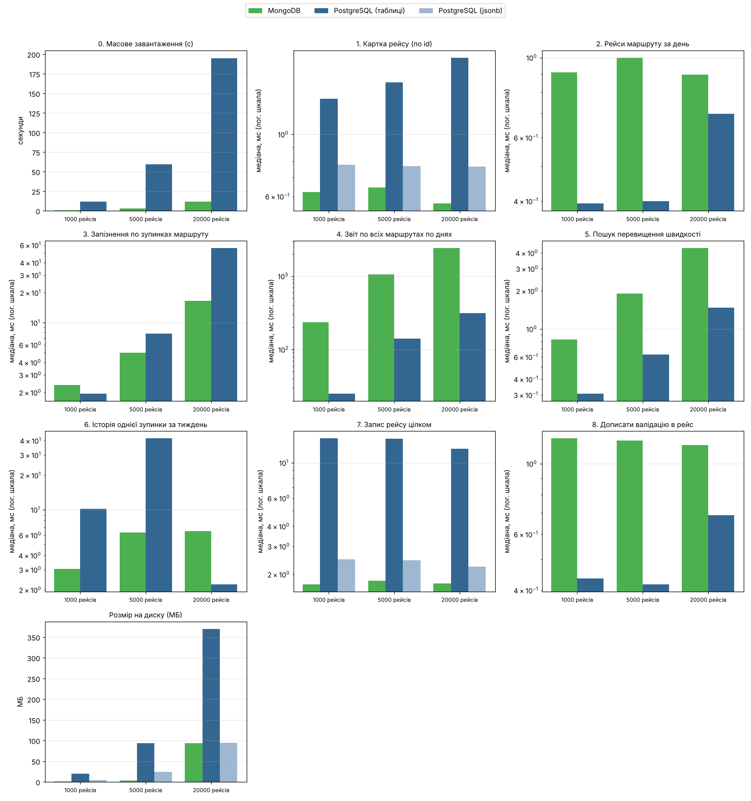

# Лабораторна 2. NoSQL

Предметна область та сама — система управління громадським транспортом (варіант 12).

## 1. Види NoSQL баз

| Тип | Як зберігає | Приклади | Для чого добре | Що погано |
|---|---|---|---|---|
| Key-value | ключ → значення (рядок, хеш, список...) | Redis, Memcached, DynamoDB | кеш, сесії, лічильники, черги, все що в пам'яті і дуже швидко | немає запитів по значенню, немає зв'язків |
| Документні | JSON/BSON документи з вкладеними об'єктами і масивами | MongoDB, CouchDB, Firestore | об'єкт, який читається і пишеться цілком; різна структура записів | джойни між колекціями, транзакції на кілька документів дорожчі |
| Колонкові (wide-column) | рядок з довільним набором колонок, дані розкладені по партиціях | Cassandra, HBase, ScyllaDB | дуже багато записів (логи, IoT), горизонтальне масштабування | запити тільки по ключу партиції, агрегації слабкі |
| Графові | вузли і ребра з властивостями | Neo4j, ArangoDB | зв'язки: соцмережі, маршрути, рекомендації | погано для масових агрегацій по всіх даних |
| Time-series | точки (час, значення, теги) | InfluxDB, TimescaleDB | метрики, телеметрія, моніторинг | вузька спеціалізація |
| Пошукові | інвертований індекс | Elasticsearch, OpenSearch | повнотекстовий пошук, логи | не основне сховище, немає транзакцій |

## 2. Чи варто щось виносити з PostgreSQL

**Що лишається в PostgreSQL.** Картки і їх баланс, поповнення, оплати, водії, машини, маршрути, розклад. Тут потрібні:
транзакції (гроші з картки не можуть зникнути або списатись двічі), зовнішні ключі, перевірки (водій без допуску не
виїде) — тобто все те, що реляційна база робить найкраще. Виносити це в NoSQL було б тільки гірше.

**Що варто винести.** Якщо розширити систему (п.3), з'являються дані з іншою природою:

1. **Архів рейсів з телеметрією → MongoDB (документна).**
   * дані пишуться один раз після рейсу і далі тільки читаються;
   * найчастіше читаються цілком: "покажи все про рейс №...", при скарзі пасажира чи розборі ДТП;
   * в SQL один рейс розкладається на 10 таблиць (trips, routes, vehicles, drivers, shifts, stops, trip_stop_events,
     trip_telemetry, validations, vehicle_types) і збирається джойнами, а в монго це один документ;
   * різні типи транспорту мають різні датчики: в автобуса рівень пального, в тролейбуса напруга в мережі,
     у трамвая струм двигуна. В SQL це колонки, які в більшості рядків null (або окремі таблиці на кожен тип),
     в монго просто різні поля в документах;
   * обсяг: 100 машин × 8 рейсів на день × ~90 точок телеметрії = ~72 тис. рядків на день тільки телеметрії,
     а зберігати треба роками. Монго шардиться по даті "з коробки";
   * історичність: в документі зберігаються назва маршруту, ПІБ водія і номер машини на момент рейсу.
     Якщо маршрут потім перейменують, архів не зміниться — для архіву це якраз правильно.
2. **Поточний стан (де зараз машини, хто на маршруті, кеш) → Redis (key-value).** Дані живуть секунди або хвилини,
   оновлюються дуже часто, потрібні GEO-запити "які машини поруч із зупинкою". Записувати кожну координату в postgres
   кожні кілька секунд — зайве навантаження (п.6).

**Аргументи проти (чесно):**
* дублювання даних: назва маршруту і водій копіюються в кожен документ, документ більший, ніж рядки в таблицях;
* запити "поперек" документів (наприклад, історія однієї зупинки по всіх рейсах) в монго незручні: треба розгортати масиви;
* дві бази = складніша підтримка, синхронізація (рейс спочатку живе в postgres, потім архівується в монго).

Висновок: всю систему переводити не треба, а архів рейсів з телеметрією — так.

## 3. Реалізація в MongoDB

Нові вимоги до системи:
* у кожній машині бортовий трекер: раз на 30 с координати, швидкість і показник датчика, який є в цьому типі транспорту;
* датчики дверей рахують, скільки зайшло/вийшло на кожній зупинці, фіксується фактичний час прибуття і запізнення;
* після закінчення рейсу формується "звіт рейсу", який зберігається 3 роки;
* диспетчер може відкрити рейс цілком, аналітики рахують пунктуальність і пасажиропотік, служба безпеки шукає перевищення швидкості.

Колекція `trips`, один документ = один рейс ([`datagen.py`](datagen.py), функція `to_doc`):

```json
{
  "_id": 4,
  "status": "finished",
  "started_at": "2026-09-01 11:31:00",
  "finished_at": "2026-09-01 12:25:27",
  "date": "2026-09-01",
  "route":   { "id": 5, "number": "5", "name": "Зупинка 177 - Зупинка 11", "type": "автобус" },
  "vehicle": { "id": 3, "plate": "AA1003KX", "model": "Богдан А70", "type": "автобус", "depot_id": 1 },
  "driver":  { "id": 15, "name": "Поліщук Олена" },
  "stops": [
    { "seq": 1, "stop_id": 177, "name": "Зупинка 177", "planned_at": "...", "arrived_at": "...",
      "departed_at": "...", "delay_sec": 16, "boarded": 11, "alighted": 0 }
  ],
  "telemetry": [
    { "ts": "2026-09-01 11:31:00", "lat": 50.472832, "lon": 30.406301, "speed": 44.5, "fuel_level": 98.7 }
  ],
  "validations": [ { "card_id": 2035, "stop_id": 177, "price": 15.0, "at": "..." } ],
  "stats": { "passengers": 118, "validations": 94, "revenue": 1207.5, "max_speed": 59.8 }
}
```

У тролейбуса замість `fuel_level` в телеметрії `line_voltage`, у трамвая `motor_current`.

Індекси: `{route.id, started_at}`, `stops.stop_id`, `telemetry.speed` (останні два — multikey, по елементах масиву).

Приклади запитів (mongosh / Compass):
```js
db.trips.findOne({ _id: 4 })                                            // картка рейсу
db.trips.find({ "route.id": 5, started_at: { $gte: ISODate("2026-09-01"), $lt: ISODate("2026-09-02") } },
              { "driver.name": 1, "vehicle.plate": 1, "stats.passengers": 1 })
db.trips.find({ "telemetry.speed": { $gt: 70 } }, { _id: 1 })            // перевищення швидкості
db.trips.aggregate([ { $match: { "route.id": 5 } }, { $unwind: "$stops" },
  { $group: { _id: "$stops.stop_id", avg_delay: { $avg: "$stops.delay_sec" } } } ])   // запізнення по зупинках
db.trips.updateOne({ _id: 4 }, { $push: { validations: { card_id: 1, stop_id: 1, price: 15, at: new Date() } },
                                 $inc: { "stats.validations": 1 } })
```

## 4. Те саме в SQL

[`sql_archive.sql`](sql_archive.sql) — до основної схеми додано `trip_stop_events` і `trip_telemetry`.
Один документ монго відповідає рядкам у таких таблицях:

| Поле документа | Таблиці PostgreSQL |
|---|---|
| `_id, status, started_at, finished_at` | `trips` |
| `route` | `routes` + `vehicle_types` |
| `vehicle`, `driver` | `shifts` → `vehicles`, `drivers` |
| `stops[]` | `trip_stop_events` + `stops` (назва) |
| `telemetry[]` | `trip_telemetry` (3 колонки датчиків, 2 з них завжди null) |
| `validations[]` | `validations` |
| `stats` | не зберігається, рахується запитом |

Додатково для порівняння: таблиця `trip_docs(id, doc jsonb)` — той самий документ, але в postgres.
Це щоб перевірити, чи виграш монго в "документі", чи саме в монго.

## 5. Тестування швидкодії

### Як тестується і чому так

* **Однакові дані.** [`datagen.py`](datagen.py) генерує дані один раз (з фіксованим seed), і вони вантажаться в обидві
  бази. Тобто порівнюються однакові рейси, а не "схожі".
* **Обсяг.** Три розміри: 1 000, 5 000 і 20 000 рейсів. 20 000 рейсів = ~50 днів роботи 100 машин,
  це ~290 тис. подій на зупинках, ~1,8 млн точок телеметрії, ~1,2 млн валідацій (в монго ~340 МБ документів).
  Кілька розмірів — щоб бачити не одну цифру, а як час росте з обсягом. Можна запустити і більше: `python bench.py 50000`.
* **Однакові індекси.** Для кожного запиту в монго є індекс, і такий самий є в postgres.
* **Чесний запис.** В монго `writeConcern { w: 1, j: true }` — чекаємо запис в журнал на диск, так само як postgres
  при commit чекає fsync. Без `j: true` монго відповідає раніше, ніж дані реально на диску, і порівняння було б нечесним.
* **Прогрів.** Перші 10 запусків кожного запиту не рахуються (кеш, план запиту), далі сотні запусків з різними
  випадковими параметрами (однаковими для всіх баз). Рахуємо медіану і 95-й перцентиль, а не середнє:
  одиничний стрибок (збирач сміття, антивірус) не зіпсує результат.
* **Однакові умови.** Обидві бази на одному комп'ютері, клієнт один (Python), один потік.
* **Перевірка відповідей.** Запити в обох базах повертають однакові результати (кількість рядків, суми).

### Сценарії

| № | Сценарій | Навіщо в системі | Що перевіряє |
|---|---|---|---|
| 0 | Масове завантаження | імпорт архіву | запис великого обсягу разом з індексами |
| 1 | Картка рейсу по id | диспетчер відкриває рейс, скарга | читання "об'єкта цілком": 1 документ vs 4 запити з джойнами |
| 2 | Рейси маршруту за день | екран диспетчера | фільтр по індексу + кількість пасажирів (в SQL рахується, в документі лежить готова) |
| 3 | Запізнення по зупинках маршруту | аналітика пунктуальності | агрегація з розгортанням масиву (`$unwind`) vs `group by` |
| 4 | Звіт по всіх маршрутах по днях | щоденна звітність | важка агрегація по всій базі |
| 5 | Пошук перевищення швидкості | служба безпеки | пошук всередині вкладеного масиву (multikey індекс) |
| 6 | Історія однієї зупинки за тиждень | аналіз зупинки | запит "поперек" документів — тут очікуємо, що SQL виграє |
| 7 | Запис рейсу цілком | кінець рейсу | 1 insert документа vs транзакція на ~150 рядків у 4 таблиці |
| 8 | Дописати валідацію в рейс | дані з валідатора прийшли пізніше | `$push` в документ vs insert рядка |
| — | Розмір на диску | вартість зберігання | таблиці + індекси vs колекція + індекси |

Чого тут немає і чому: паралельних клієнтів (лаба про модель даних, а не про налаштування серверів під навантаження),
шардингу і кластера (одна машина), "холодного" кешу (на Windows його не скинеш чесно, а в реальній роботі
гарячі дані і так в пам'яті).

### Результати

Повні цифри: [`results/results.md`](results/results.md), сирі дані: [`results/results.csv`](results/results.csv),
лог запуску: [`results/bench_log.txt`](results/bench_log.txt).



### Висновки

Цифри для 20 000 рейсів (медіана), MongoDB 9.0 і PostgreSQL на одному ноутбуці з Windows:

| Сценарій | MongoDB | PG таблиці | PG jsonb | Хто швидший |
|---|---|---|---|---|
| 1. Картка рейсу | 0.57 мс | 1.88 мс | 0.77 мс | монго в 3.3 рази |
| 2. Рейси маршруту за день | 0.90 мс | 0.70 мс | — | приблизно однаково |
| 3. Запізнення по зупинках | 16.6 мс | 56.0 мс | — | монго в 3.4 рази |
| 4. Звіт по всіх маршрутах | 2406 мс | 311 мс | — | postgres в 7.7 рази |
| 5. Перевищення швидкості | 4.4 мс | 1.5 мс | — | postgres в 3 рази |
| 6. Історія зупинки | 6.5 мс | 2.2 мс | — | postgres в 2.9 рази |
| 7. Запис рейсу | 1.75 мс | 12.3 мс | 2.2 мс | монго в 7 разів |
| 8. Дописати валідацію | 1.15 мс | 0.69 мс | — | postgres в 1.7 рази |
| Розмір на диску | 94 МБ | 369 МБ | 95 МБ | монго/jsonb в 4 рази менше |

1. **Робота з рейсом як з цілим (1, 7) — документ виграє.** Прочитати рейс: монго читає 1 документ, postgres робить
   4 запити з джойнами. Записати рейс: 1 insert проти транзакції на ~150 рядків у 4 таблиці — різниця в 7 разів.
   І час майже не залежить від обсягу бази (0.6 мс і на 1000, і на 20000), бо це пошук по первинному ключу.
2. **Але виграш дає саме модель "документ", а не конкретно монго.** Postgres з jsonb майже так само швидкий
   (0.77 мс читання, 2.2 мс запис) і займає стільки ж місця. Тобто якщо вже є postgres, архів можна тримати в jsonb.
   Монго виграє тим, що з документом зручніше працювати (запити по вкладених полях, індекси по масивах, шардинг).
3. **Агрегації по всій базі (4) — postgres у 8 разів швидший.** Монго мусить прочитати всі документи повністю
   (340 МБ разом з телеметрією, яка в цьому звіті не потрібна), а postgres читає тільки вузькі таблиці подій зупинок
   і валідацій. Це головний мінус документної моделі: зайві дані лежать "поруч" і читаються разом із потрібними.
4. **Агрегація в межах маршруту (3) — монго швидший.** Документи одного маршруту знаходяться по індексу, а дані
   зупинок вже лежать усередині. Postgres для того самого джойнить `trips` з 290 тис. рядків `trip_stop_events`,
   і з ростом бази час росте швидше (2 → 8 → 56 мс), ніж у монго (2 → 5 → 17 мс).
5. **Пошук усередині масивів і "поперек" документів (5, 6) — postgres швидший.** Один рядок телеметрії в postgres
   = один запис індексу, а в монго індекс по `telemetry.speed` знаходить документ, який потім треба прочитати цілком.
   На 1000 і 5000 рейсів сценарій 6 у postgres був повільніший: там даних лише на 3 і 13 днів, тож "тиждень" — це
   майже вся таблиця, і запит перестає бути вибірковим. На 20 000 рейсів (51 день) postgres іде по індексах і виграє.
6. **Дописати в документ (8) — postgres трохи швидший.** `$push` у монго переписує документ розміром ~17 КБ,
   а postgres просто додає маленький рядок.
7. **Розмір.** Монго зберігає документи стиснуто (snappy), тому при дублюванні назв маршрутів і водіїв у кожному документі
   займає в 4 рази менше за нормалізовані таблиці з індексами. Postgres jsonb так само стискає великі значення (TOAST).
   _На 1000 і 5000 рейсів розмір монго занижений: монго ще не встиг скинути дані на диск (checkpoint раз на 60 с).
   У коді це вже виправлено (`fsync` перед вимірюванням), достовірна цифра — для 20 000._
8. **Масове завантаження** в монго в ~17 разів швидше. Але це не зовсім чесне порівняння: в час postgres входить
   завантаження і таблиць, і jsonb-копії, а також `VACUUM ANALYZE`.

**Загальний висновок.** Результати збіглися з тим, що очікувалось у п.2: архів рейсів, який пишеться один раз і
читається цілком, вигідніше тримати як документи (в монго або в jsonb) — запис у 7 разів швидший, читання в 3 рази.
А звітність по всіх даних і пошук по окремих подіях краще робити в реляційних таблицях. Тому розумна схема —
не "замінити postgres на монго", а тримати архів у монго, а для важких звітів раз на добу
рахувати агрегати в postgres (або одразу зберігати готові `stats` в документі, як це вже зроблено).

## 6. Redis (key-value)

Інший тип NoSQL — Redis. В системі він відповідає за "живі" дані, які потрібні тільки зараз:
де машини, хто на маршруті, кеш, лічильники за день, захист від подвійної оплати.

[`redis_demo.py`](redis_demo.py), вивід — [`results/redis_demo.txt`](results/redis_demo.txt).

| Структура | Команди | Для чого в системі |
|---|---|---|
| String + TTL | `SET ... EX`, `GET`, `TTL` | кеш інформації про маршрут на 5 хв |
| Hash | `HSET`, `HGETALL`, `HINCRBY`, `EXPIRE` | поточний стан машини (маршрут, швидкість, пасажири); зникає, якщо трекер мовчить 2 хв |
| Geo | `GEOADD`, `GEOSEARCH`, `GEODIST` | які машини в радіусі 2 км від зупинки, відстань між зупинками |
| Set | `SADD`, `SMEMBERS`, `SISMEMBER`, `SCARD` | які машини зараз на маршруті |
| Sorted set | `ZINCRBY`, `ZREVRANGE` | топ завантажених зупинок за день |
| `SET NX EX` | | одну картку не можна списати двічі протягом хвилини |
| List | `LPUSH`, `LTRIM`, `LRANGE` | стрічка останніх 100 валідацій |
| Stream | `XADD`, `XLEN`, `XRANGE` | потік телеметрії, з якого рейс потім пишеться в монго |
| Counter | `INCR` | кількість проходів за день |
| Keys | `KEYS`, `DEL`, `EXISTS` | |

Те саме вручну через `redis-cli`:
```
SET route:24 "{\"name\":\"Вокзальна - Дарниця\"}" EX 300
HSET vehicle:AA1234KX route 24 speed 31 passengers 0
GEOADD vehicles:pos 30.4950 50.4415 AA1234KX 30.5220 50.4490 AA7710KX
GEOSEARCH vehicles:pos FROMLONLAT 30.5234 50.4501 BYRADIUS 2 km ASC WITHDIST
ZINCRBY stops:boarded:2026-11-09 15 "Університет"
ZREVRANGE stops:boarded:2026-11-09 0 2 WITHSCORES
SET card:1000000101:lock AA1234KX NX EX 60
```

## Запуск

Потрібні: PostgreSQL (як для першої лаби), MongoDB Community Server, Redis.

```
cd nosql
pip install -r requirements.txt
python redis_demo.py
python bench.py            # або python bench.py 1000 5000 20000 50000
```
На Windows — `run_nosql.bat`.
